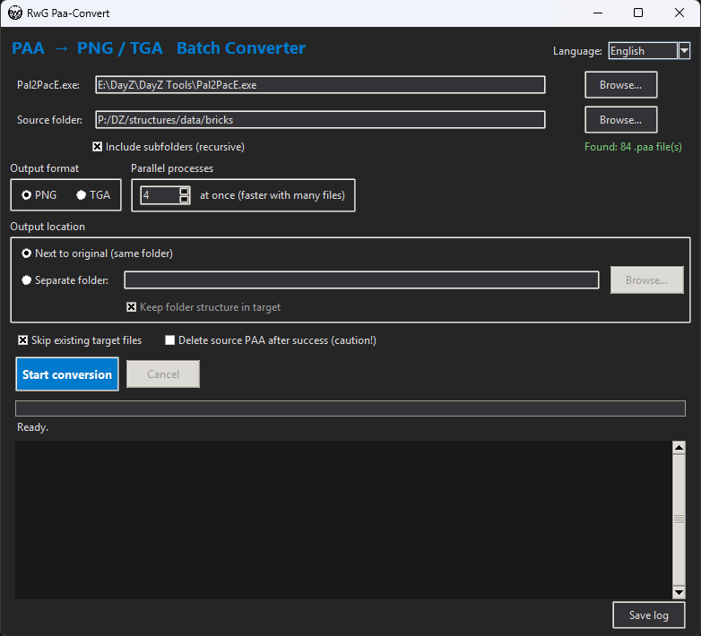
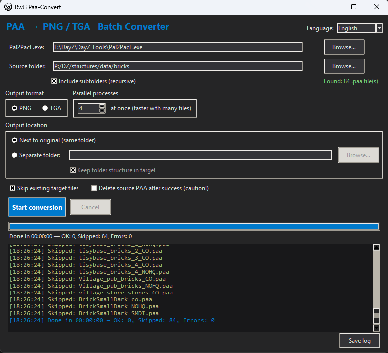

# RwG Paa-Convert

A small, portable GUI tool for **batch-converting DayZ / Arma `.paa` textures to PNG or TGA** using Bohemia Interactive's `Pal2PacE.exe`. Point it at a folder, pick a format, hit start — with a progress bar, live log, ETA and parallel conversion.

Multilingual via an editable **`Stringtable.csv`** (Arma/DayZ-style format), 10 languages included.



---

## Features

- **PNG or TGA** output, chosen with a single click.
- **Source folder** picker with an **"Include subfolders (recursive)"** checkbox.
- **Output location**: next to the original file, or a **separate folder** (optionally keeping the sub-folder structure).
- **Skip existing** target files — great for re-runs.
- **Delete source `.paa` after success** (optional, off by default).
- **Parallel conversion** — run several `Pal2PacE.exe` processes at once for a big speed-up on large batches.
- **Progress bar, colored live log, file counter and ETA**, plus a **Cancel** button.
- **Live language switching** via a dropdown; the choice is remembered.
- **Portable**: settings and the string table live next to the program, nothing is written to the registry or your user profile.
- Remembers all settings in `RwG_Paa_Convert.settings.json`.



---

## Download & run (portable `.exe`)

1. Go to the [**Releases**](https://github.com/rv103/RwG-Paa-Convert/releases) page.
2. Download `RwG_Paa_Convert.exe` (or the `RwG-Paa-Convert-portable.zip`, which also contains an editable `Stringtable.csv`).
3. Put the `.exe` in any folder and double-click it. No installation, no Python required.

The `.exe` is self-contained (built with PyInstaller). On first run it creates
`RwG_Paa_Convert.settings.json` **next to the `.exe`**, and if you place a
`Stringtable.csv` next to the `.exe` it is used instead of the built-in one — so
the tool stays fully portable.

---

## Run from source (Python)

Requires **Python 3.8+** (Tkinter is included with the standard Windows installer).

```bash
python RwG_Paa_Convert.py
```

Or double-click `RwG_Paa_Convert.bat` on Windows (it uses `pyw`/`pythonw`, so no console window stays open).

---

## Usage

1. Pick **`Pal2PacE.exe`** (the tool tries to auto-detect it on first start).
2. Pick the **source folder** with your `.paa` files.
3. Toggle **Include subfolders** if you want to recurse.
4. Choose **PNG** or **TGA**.
5. Choose the **output location** (in place, or a separate folder).
6. Optionally enable *skip existing*, *delete source*, and set the number of **parallel processes**.
7. Click **Start conversion**. Use **Cancel** to stop running processes.

`Pal2PacE.exe` derives the target format from the output extension. Per file the tool runs:

```
Pal2PacE.exe "<input.paa>" "<output.png|tga>"
```

---

## Languages / String table

All UI texts live in **`Stringtable.csv`** in the classic Arma/DayZ format:
the first column is the key (`STR_RWG_…`), each further column is a language.

Included: **English, German, French, Spanish, Italian, Portuguese, Polish, Russian, Czech, Chinese**.

**Add a language:**

1. Add a new column with the language name to the header row.
2. Fill in the translation for each row.

Empty cells automatically fall back to English. If `Stringtable.csv` is missing
entirely, the program uses its built-in English/German texts.

---

## Building the `.exe` yourself

Releases are built automatically by GitHub Actions on a Windows runner (see
`.github/workflows/release.yml`). To build locally on Windows:

```bat
build_exe.bat
```

or manually:

```bat
pip install pyinstaller
pyinstaller --noconfirm --onefile --windowed --name RwG_Paa_Convert ^
  --icon RwG_Logo.ico ^
  --add-data "Stringtable.csv;." ^
  --add-data "RwG_Logo.ico;." ^
  RwG_Paa_Convert.py
```

The result is `dist\RwG_Paa_Convert.exe`.

---

## Requirements

- Windows (for `Pal2PacE.exe`; the GUI itself is cross-platform Tkinter).
- `Pal2PacE.exe` from the Arma 3 Tools / DayZ Tools.

## Credits

- Conversion is done by **`Pal2PacE.exe`** © Bohemia Interactive.
- Part of the **RwG** DayZ modding tools.

## License

Licensed under the **GNU General Public License v3.0** — see [LICENSE](LICENSE).
